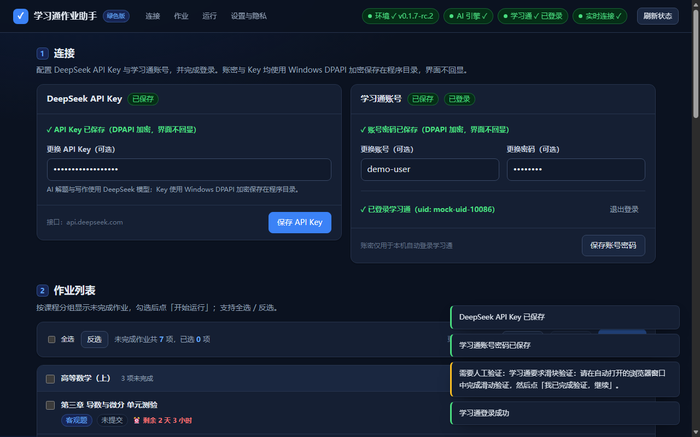
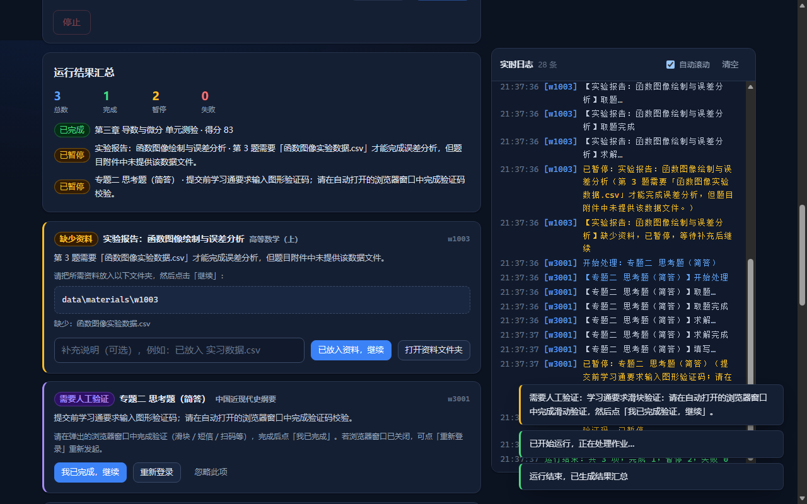
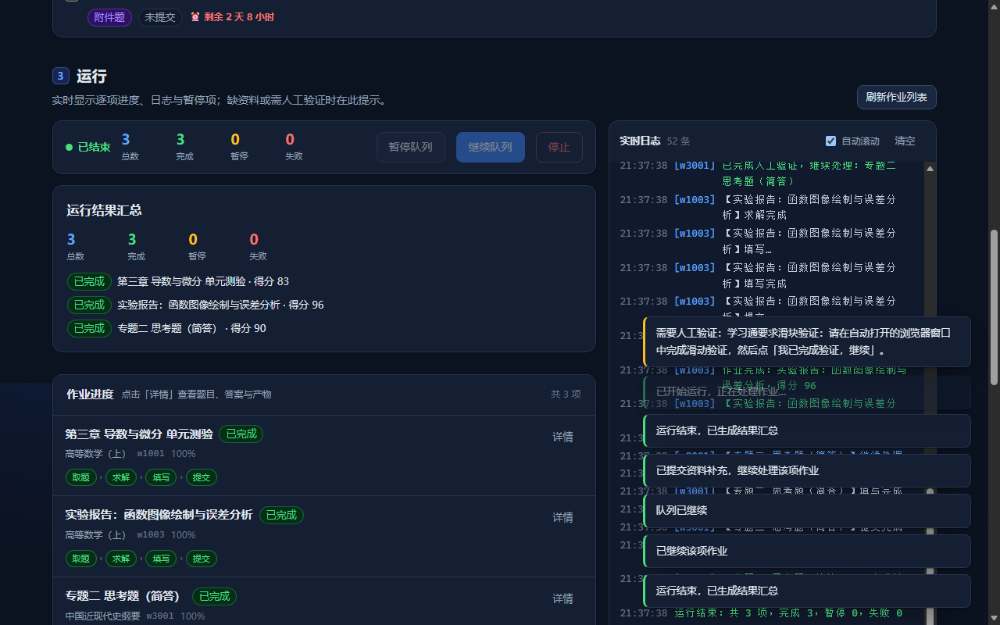

# 学习通作业助手 · Chaoxing Homework Assistant

> 一个绿色免安装的 Windows 桌面小工具：自动登录学习通、列出未完成作业，由 AI 辅助完成客观题、主观题和附件题，并自动提交。支持**图片识题**（拍照/截图直接识别），附件作业会自动生成 Word 文档并上传。
>
> **作者：七号玩家（sevenplayer / Lsy）**
> **Powered by DeepSeek（AI 辅助开发）**
> 开源协议：MIT License

> **v1.5.0（2026-11-25）更新**
> - 新增**目标正确率**五档滑块（99/90/80/60/30），只作用于选择题/填空题，按题数比例近似；30% 档标红警告。
> - 修复**关闭自动提交后显示“已完成”但学习通进度为 0**：现在会暂存并显示「待提交」。
> - 主观题/附件题**提交前暂停确认**，可打开作业页检查后再提交。
> - 缺资料暂停会列出题号、题型、题干摘要（AI 定位仅供参考）。
> - 报错会同时显示“人话解析 + 建议”和原始错误详情。
>
> **v1.4.0（2026-11-24）**：修复 AI 引擎自检失败（DSH 运行目录初始化/隐私补丁/API Key 同步）。

---

## 功能特性

- **免安装绿色版**：解压即用，不写注册表、不装服务、不需要管理员权限；所有数据只保存在程序目录。
- **账号密码登录**：浏览器自动化 + Cookie 持久化；遇到滑块/安全验证时人工完成一次即可。
- **自动检索未完成作业**：按课程分组，多选后批量执行。
- **客观题（单选/多选/判断/填空）**：联网检索后自动填写并提交；大批量（如 252 题）自动分批求解。
- **主观题 / 附件题**：AI 生成 Word 文档；有模板时按模板填充，并直接上传到学习通附件框。
- **图片识题**：把题目/教材页拍照放进资料目录，自动 OCR 成文字再解题；识别结果有缓存。
- **缺资料暂停、可继续**：暂停当前作业并继续后面的，补充资料后一键继续；已解出的题不会重做。
- **内容审核兜底**：个别题被 AI 拒绝时，拆单题 / 检索兜底，仍不行可手填 `manual-answers.json`。
- **隐私隔离**：学习通账密、DeepSeek API Key、Cookie 均用 Windows DPAPI 加密；独立 Edge 配置；一键清除本地数据。
- **目标正确率（近似）**：五档滑块 99/90/80/60/30，只对选择题/填空题按题数比例故意改错；30% 有红色警告。
- **提交前确认**：关闭自动提交时暂存并标记「待提交」；主观题/附件题默认暂停确认。
- **缺资料定位**：暂停时列出题号、题型、题干摘要（AI 定位，仅供参考）。
- **人话报错**：错误同时显示可操作建议与原始技术详情。
- **简易 UI**：单页四区块（连接 / 作业列表 / 运行 / 设置与隐私），实时日志和进度。

## 界面预览







## 快速开始（普通用户）

1. 在 Releases 下载 `学习通作业助手_v1.5.0.zip`，解压到普通文件夹（支持中文/空格路径，不要放 `Program Files`）。
2. 双击 **`01_环境准备（首次）.cmd`**（只第一次；联网下载便携 Node.js + DSH，约 3–8 分钟；已有环境可跳过）。
3. 双击 **`02_启动.cmd`**，浏览器会自动打开 `http://127.0.0.1:8765/`。
4. 在「① 连接」里填写：
   - **DeepSeek API Key**（在 <https://platform.deepseek.com/> 申请并充值）；
   - **学习通账号 + 密码**，点「登录」（需要滑块时在弹出窗口手动完成一次）。
5. 点「刷新作业」→ 勾选 → 「开始运行」。
6. 需要资料时把图片/文本/模板放进 `data\materials\<workId>\`，点暂停卡片的「继续」。
7. 用完双击 **`03_停止服务.cmd`**。

更完整的图文步骤见 [`docs/使用须知.md`](docs/使用须知.md)。

## 隐私与安全

- 所有数据只保存在程序目录的 `data\`、`logs\` 内；不写注册表、不装系统服务、不写用户目录。
- 学习通账号密码、DeepSeek API Key、学习通 Cookie 使用 Windows DPAPI（CurrentUser）加密。
- 受控浏览器使用独立 Edge 配置（`data\edge-profile\`），不影响日常浏览器。
- 可在「设置与隐私」一键清除机密 / 登录态 / 日志 / 全部数据。
- **不要把自己的 `data\` 目录发给别人**；卸载 = 停止服务后删除整个程序目录。

## 工作原理（简要）

- **UI/服务**：本地 Node HTTP 服务提供静态页面 + REST + SSE，所有数据留在本机。
- **学习通核心**：Edge + Chrome DevTools Protocol 自动登录；课程/作业/题目解析；填答、暂存、提交、附件上传。
- **AI 引擎**：调用 DeepSeek Harness CLI（headless 模式）完成题目求解、主观题撰写、文档生成；使用私有 DSH_HOME 隔离，并关闭会话日志上传与遥测。
- **图片识题**：调用 DeepSeek Messages 图像接口（`deepseek-flash`）做 OCR，结果缓存到 `data/ocr-cache/`。
- **文档生成**：零依赖 OOXML（ZIP + XML）读写，支持新建 docx 与按模板填充。

## 目录结构

```
学习通作业助手/
├─ 00_先看这里_使用须知与步骤.txt   # 使用说明（分发版）
├─ 01_环境准备（首次）.cmd
├─ 02_启动.cmd
├─ 03_停止服务.cmd
├─ app/          # 本地服务、编排器、配置/密钥
├─ cx/           # 学习通核心（登录/课程/作业/提交/附件）
├─ engine/       # AI 引擎、提示词、解析、DOCX 生成、视觉 OCR
├─ ui/           # 简易 Web UI
├─ docs/         # 文档与截图
└─ data/ logs/   # 运行数据（自动生成）
```

## 开发与构建

环境：Windows 10/11 x64、Node.js ≥ 22、Microsoft Edge。

```powershell
# 运行本地服务（开发）
node app\server.mjs

# 冒烟测试（无需真实账号/AI）
node tests\smoke.mjs

# 学习通核心离线单测
node cx\test\parse.test.mjs
node cx\test\mock.test.mjs

# AI 引擎自测（需本机已配置 DeepSeek API Key）
node engine\selftest.mjs

# 构建分发包（输出到 output\）
$env:CX_DIST='1'; node build-portable.mjs
```

更多设计与实现细节见 [`docs/设计说明.md`](docs/设计说明.md)。

## 已知限制

- 仅支持 Windows 10/11（x64）；浏览器自动化依赖 Microsoft Edge。
- AI 生成内容可能有误，提交前请核对；内容审核可能拒绝个别题目，需要手动兜底。
- 首次环境准备需要联网；离线使用可在一台机器准备后整目录拷贝（不要带 `data\`）。
- 学习通页面改版可能导致解析失效，需要更新对应模块。

## 常见问题

- **AI 引擎自检失败 / AI 引擎不可用**：v1.4 会自动初始化/修复 `data\dsh-home` 并同步已保存的 API Key；仍失败时重新保存一次 API Key，或删除 `data\dsh-home\` 后重试，界面会显示具体错误原因。
- **启动时提示找不到 DSH**：v1.3+ 会自动识别便携 Node、扩展搜索系统/便携 DSH，并可在缺失时自动补装。
- **图片资料无法识别**：换清晰图片，或在同目录放 `题目.txt` 文字版。

## 免责声明

本工具仅用于协助整理与填写**本人**作业，与超星/学习通官方无任何隶属关系。
AI 生成内容可能存在错误，请务必核对后再提交。请遵守学校及平台的使用规定；
因使用本工具产生的任何后果由使用者自行承担。

## 许可证与作者

- License: [MIT](LICENSE)
- Copyright (c) 2026 **七号玩家（sevenplayer / Lsy）**
- Powered by **DeepSeek**（AI 辅助开发）

> GitHub 仓库：<https://github.com/3462974075-jpg/chaoxing-homework-assistant>
>
> 更新记录见 [CHANGELOG.md](CHANGELOG.md)。
